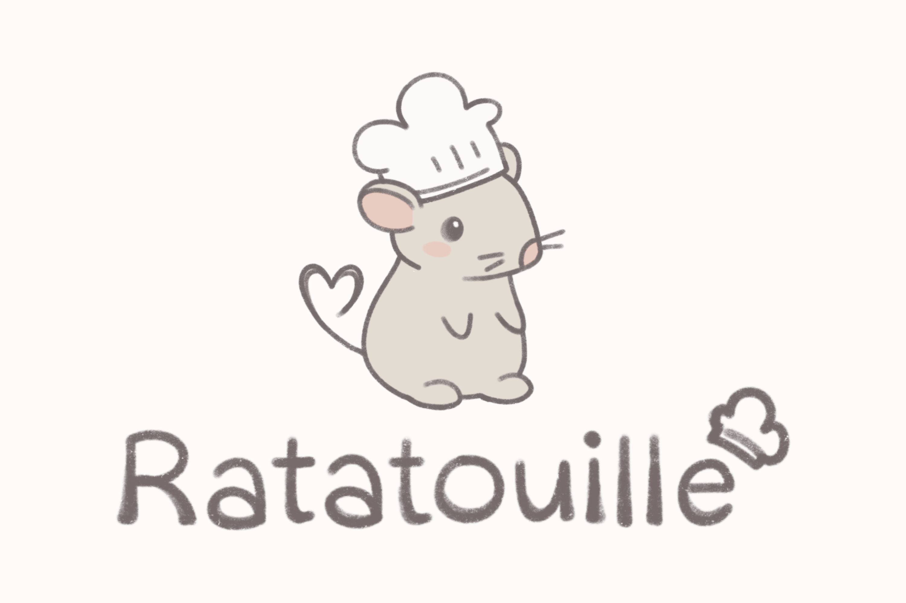
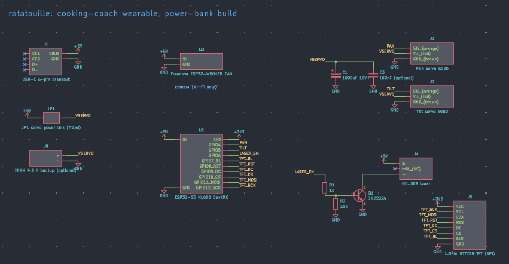
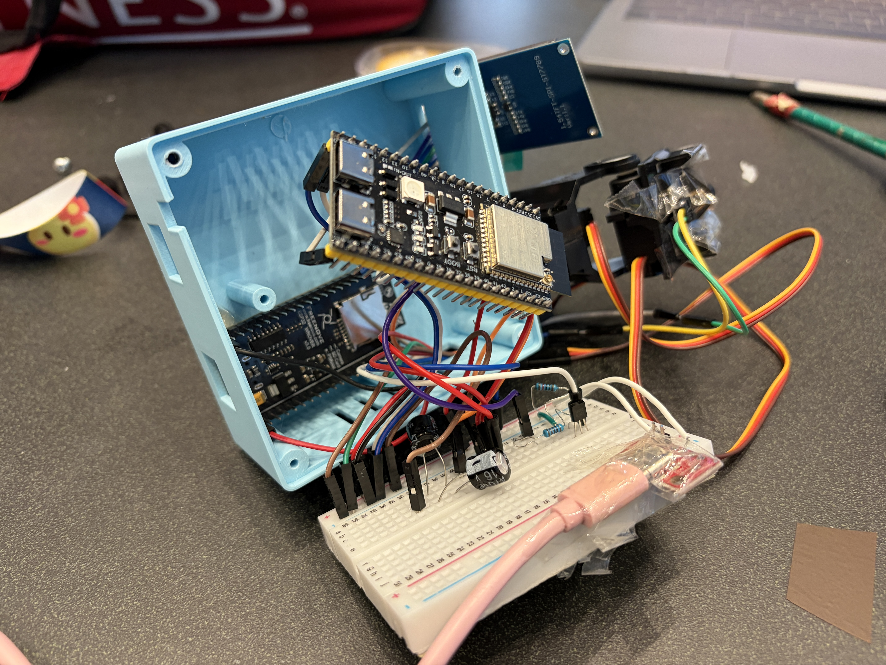

<div align="center">


    
# 🧑‍🍳 Ratatouille (Remy)
A hands-free cooking coach you wear on your chest

</div>

   
   
**Mitigate the new recipe learning experience!**
   
Remy hears you, sees your counter, walks you through a recipe one step at a time, and points a laser at the thing you need ("the lime, on your left") by turning its tilt module. 

[Watch the Skit Demo](https://www.youtube.com/watch?v=ML1AmkTEyEA)   
   
[View the Devpost](https://devpost.com/software/ratatouille-u86zig)

## Hardware Assembly
The schematic was designed on KiCad:    
   


This is what the inside looks like:     
   
   

After desiging the enclosure, everything was assembled into the enclosure:   
     
     
## Key Features

- **Talks like a person.** Say "hey Remy, let's make guacamole". It answers in one or two short sentences, looks at
  the camera before it replies, and stops the moment you interrupt.
- **Points.** Open-vocabulary object detection finds the ingredients and tools, and a servo-aimed laser lands on the
  one you need.
- **Keeps your place.** It knows which step you're on, moves on when you say "done", and answers "where was I?".
- **Checks in.** A second model watches the counter every few seconds. After a quiet spell or at a new step, Remy may
  offer a nudge or a tip, and it never talks over you.
- **Accessible by design.** "Say it simpler" switches to short plain sentences with one action each. "Talk less"
  turns the check-ins down. Captions are big, with light and dark high-contrast themes and a dyslexia-friendly
  font. It never rushes you.
- **Never goes silent.** If the AI is slow or down, it retries on a faster model, then reads the step's pre-written
  line. If the camera drops, it keeps coaching by voice.
- **Safe laser.** It's under 5 mW, clamped below horizontal, and the firmware turns it off within 0.5 s if the
  laptop goes quiet.

## How it fits together

```
 ON THE CHEST                          LAPTOP (one Python asyncio app)                     CLOUD
 ESP32 WROVER CAM ──MJPEG/WiFi──▶  frames ─▶ YOLO-World ─▶ aimer ──┐
 ESP32-S3: servos, ◀──UDP 30 Hz──  control link ◀──────────────────┘
   laser, TFT                      Pipecat: mic ─▶ VAD ─▶ STT ─▶ intent router ─────────▶ Deepgram
 mic, speaker ◀──▶ laptop audio                         └─▶ agent ─▶ TTS ─▶ speaker     ▶ Claude
                                   check-ins, watcher, dashboard (http://localhost:8000)
```

The laptop is the hub. The two boards never talk to each other or to the cloud. Local parts (voice detection,
YOLO, the intent router) act at once, while Claude is still thinking, so the laser moves before the answer starts.
Details: [docs/architecture.md](docs/architecture.md).

| Part | Tech |
|---|---|
| Camera board | Freenove ESP32 WROVER CAM (OV3660), MJPEG stream |
| Controller | ESP32-S3: 2 × SG90 pan-tilt, 650 nm laser through an NPN switch, 1.54" ST7789 TFT |
| Vision | YOLO-World fine-tuned on our own camera frames (`laptop/yolo-world-guac.pt`), on the laptop GPU; calibration maps camera pixels to servo angles |
| Voice | Pipecat, Silero VAD, Deepgram streaming STT + Aura TTS, a local intent router (keywords, fuzzy match, MiniLM) |
| Brain | Claude Opus 5.5 (low effort, fast mode) with tools `point_at`, `laser_off`, `propose_done`, `show_text`, `show_image`; Claude Haiku 5.5 as the backup and the watcher |
| Dashboard | FastAPI + React/TypeScript (Vite), also a phone page at `/cook` |
| Enclosure | OpenSCAD, 3D printed; schematic in KiCad |

## Running it

macOS (Apple silicon), Python 3.12.

```bash
brew install portaudio
cd laptop
python3.12 -m venv .venv && source .venv/bin/activate
pip install -r requirements.txt
cp .env.example .env        # add ANTHROPIC_API_KEY and DEEPGRAM_API_KEY
```

No hardware needed for these:

```bash
python -m coach.main --type --no-s3 --no-yolo --cam black   # type instead of talking, fake laser
python -m coach.main --no-s3 --cam 0                        # talk to it, laptop webcam
python -m tools.try_dashboard                               # the dashboard with fake data
```

Open http://localhost:8000 for the dashboard (or `/cook` on a phone on the same WiFi).

With the hardware (full checklist: [docs/bringup.md](docs/bringup.md)):

1. Flash `firmware/camera` and `firmware/control_s3` (see each folder's README). Put both boards and the laptop
   on one 2.4 GHz phone hotspot.
2. `python ../tools/check_hw.py` checks the camera stream and the S3.
3. `python -m coach.jog` finds the pan/tilt range the camera can see, then `python -m coach.calib_web` calibrates
   (click the laser dot, or "Auto").
4. `python -m coach.main`, then say "hey Remy".

Tests: `cd laptop && python -m pytest -q`. Manual test guide: [docs/testing.md](docs/testing.md).

## Repo layout

```
firmware/
  camera/          ESP32 WROVER CAM: MJPEG stream
  control_s3/      ESP32-S3: UDP commands -> servos, laser, TFT
  servo_test/      bench test sketch
hardware/
  enclosure/       OpenSCAD box, lid and laser holder
  kicad/           schematic (generated by gen_kicad.py)
laptop/
  coach/           the Python app (main.py is the entry point); static/ = built web pages
  frontend/        dashboard and phone page source (React + Vite)
  recipes/         recipe JSON: steps, objects to look for, aliases
  tests/           unit tests
  tools/           YOLO tools: try, capture, label, evaluate, train
tools/             fake S3, hardware check, aiming sim, LLM benchmark, recipe importer, live API checks
docs/              see below
```

## Docs

- [Architecture](docs/architecture.md): what runs where, one turn step by step, failure handling
- [Hardware](docs/hardware.md): parts, pins, wiring, schematic
- [Bring-up](docs/bringup.md): from a cold box to a calibrated laser, step by step
- [Aiming](docs/aiming.md): where the pointing error comes from and how calibration fixes it
- [Protocol](docs/protocol.md): laptop ↔ S3 UDP messages
- [Design notes](docs/design-notes.md): constraints, decisions, what we cut and why, gotchas
- [Testing](docs/testing.md): how to test each part by hand

## License

[MIT](LICENSE)

---

Built with 🩵 in 36 hours at Hack Western 2026 by Jamie, Hanjing and Chloe.
