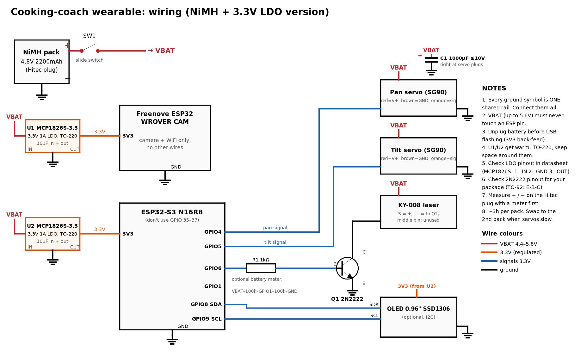

# Hardware

## Parts

| Part | Status | Notes |
|---|---|---|
| Freenove ESP32 WROVER CAM (5.7×2.8 cm) | have | Onboard USB, no programmer needed |
| ESP32-S3 N16R8 dev board (dual USB-C) | have | Flash via the COM port. Avoid GPIO 35-37 (octal PSRAM). |
| Mini pan-tilt kit, assembled, 2× SG90 | buying | Get 2× MG90S spares (metal gears) |
| KY-008 laser 650 nm | have | ≤5 mW. Driven through a 2N2222 low-side switch. |
| 20000 mAh 22.5 W power bank | have | Main power: its USB-A port → USB-A-to-C cable → USB-C breakout (J1) on the carrier's 5 V rail |
| USB-C breakout, **with 5.1 kΩ on CC1 and CC2** ("5V sink" / "power only" board) + USB-A-to-C cable (≥2 A) | buy | J1. Plain socket boards with no resistors give 0 V from a C-to-C cable. |
| Friend's 4.8 V NiMH packs ×2 | backup | Servo-only power if the boards brown out (see schematic) |
| BT mic, BT speaker | have | Paired to the laptop |
| 1.54" 240×240 ST7789 TFT (SPI) | have | Status display. Needs the version on a small PCB with 8 header pins; a bare screen with a 12-pin 0.7 mm ribbon needs an adapter. |
| 2N2222, 1 kΩ, 10 kΩ, 1000 µF, 100 nF, 2-pin header + jumper cap, jumpers, long headers, mini breadboard, perfboard | buy | 10 kΩ keeps the laser off during boot; header + cap is JP1 |

## Pins (ESP32-S3)

| GPIO | Use |
|---|---|
| 4 | Pan servo signal |
| 5 | Tilt servo signal |
| 6 | Laser, via 1 kΩ to the 2N2222 base |
| 7 | TFT backlight (BLK) |
| 8 | TFT reset (RES) |
| 9 | TFT data/command (DC) |
| 10 | TFT chip select (CS) |
| 11 | TFT data (module pin "SDA" = SPI MOSI) |
| 12 | TFT clock (module pin "SCL" = SPI SCK) |
| 1 | Optional battery divider (100k/100k) |

## Servo power capacitor (required)

Servos pull current spikes when they start moving, which dips the 5 V rail (ESP resets, servo
jitter, camera glitches). Put a **470-1000 µF electrolytic, ≥10 V** across the servo 5 V and GND,
right where the servo leads plug in. Optionally add a **100 nF ceramic** in parallel.
**Polarity:** the striped leg goes to GND. This is needed with either battery.

## Schematic

**KiCad:** [`hardware/kicad/ratatouille.kicad_pro`](../hardware/kicad/) (power-bank build, NiMH backup through JP1/J6).
It's generated by `gen_kicad.py`, so edit the script and re-run it. Preview: 

NiMH + 3.3 V regulator version: 

Power-bank version (the main plan) is the same minus U1/U2 and the switch: 5 V from the bank goes into
both boards' **5V** pins, plus the servos and laser. All grounds are common.
