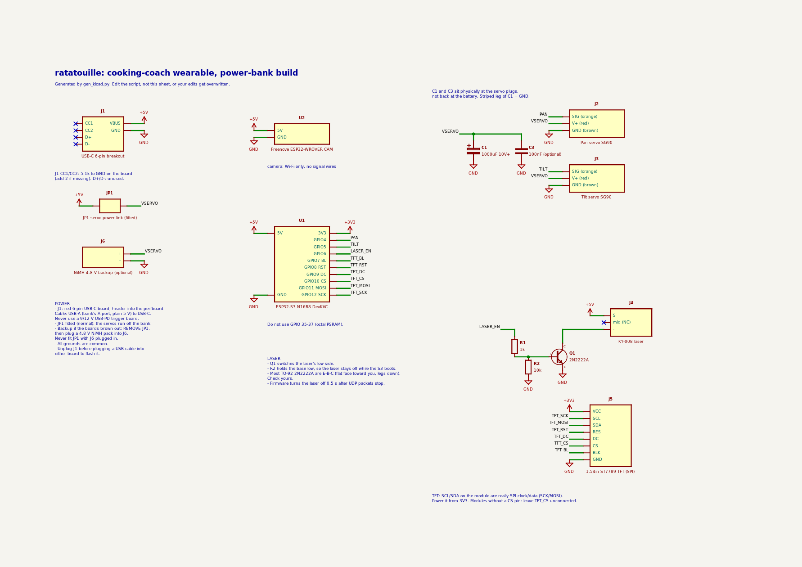

# Hardware

## Parts

| Part | Notes |
|---|---|
| Freenove ESP32 WROVER CAM (OV3660), 5.7 × 2.8 cm | Camera board. Onboard USB, no programmer needed. |
| ESP32-S3 **N8R2** dev board (dual USB-C) | Controller. 8 MB flash, 2 MB quad PSRAM. Arduino: PSRAM "QSPI PSRAM" (or Disabled), Flash Size 8MB. Flash via the COM port. |
| Mini pan-tilt kit with 2 × SG90 | MG90S (metal gears) are drop-in spares. |
| KY-008 laser, 650 nm, ≤5 mW | Driven through an NPN low-side switch (Q1). |
| Q1: small NPN transistor, TO-92 | We used an **S9014**; an S8050 (500 mA) or 2N2222 works the same. Check the pinout (often E-B-C). PNP parts (S9012, S8550, 2N3906) won't work. The laser draws ~30-40 mA. The schematic says 2N2222A; the wiring is the same. |
| 1.54" 240 × 240 ST7789 TFT (SPI) | Status display. Get the version on a small PCB with 8 header pins. |
| 20000 mAh 22.5 W power bank | Its USB-A port → USB-A-to-C cable → USB-C breakout (J1) on the carrier's 5 V rail. |
| USB-C breakout **with 5.1 kΩ on CC1 and CC2** ("5V sink" board) | Plain socket boards with no resistors give 0 V from a C-to-C cable. |
| Mic + speaker | Paired to the laptop, not the boards. A 2.4 GHz lav mic has the lowest latency. |
| 1 kΩ, 10 kΩ, 470-1000 µF (≥10 V), 100 nF, perfboard, headers, jumpers | 1 kΩ = laser base resistor, 10 kΩ = base pulldown (laser off during boot), the big capacitor goes at the servo plugs. |
| 4.8 V NiMH pack (optional) | Backup servo-only power if the boards brown out (see the schematic). |

## Pins (ESP32-S3)

| GPIO | Use |
|---|---|
| 4 | Pan servo signal |
| 5 | Tilt servo signal |
| 6 | Laser, via 1 kΩ to the Q1 base |
| 7 | TFT backlight (BLK) |
| 8 | TFT reset (RES) |
| 9 | TFT data/command (DC) |
| 10 | TFT chip select (CS) |
| 11 | TFT data (module pin "SDA" = SPI MOSI) |
| 12 | TFT clock (module pin "SCL" = SPI SCK) |
| 1 | Optional battery divider (100k/100k) |

## Servo power capacitor (required)

Servos pull current spikes when they start moving, which dips the 5 V rail (ESP resets, servo
jitter, camera glitches). Put a **470-1000 µF electrolytic, ≥10 V** across the servo 5 V and GND,
right where the servo leads plug in. Optionally add a **100 nF ceramic** in parallel.
**Polarity:** the striped leg goes to GND. This is needed with either battery.

## Schematic

**KiCad:** [`hardware/kicad/ratatouille.kicad_pro`](../hardware/kicad/) (power-bank build, NiMH backup through JP1/J6).
It's generated by `gen_kicad.py`, so edit the script and re-run it. Preview: 

NiMH + 3.3 V regulator version: 

Power-bank version (the main plan) is the same minus U1/U2 and the switch: 5 V from the bank goes into
both boards' **5V** pins, plus the servos and laser. All grounds are common.
